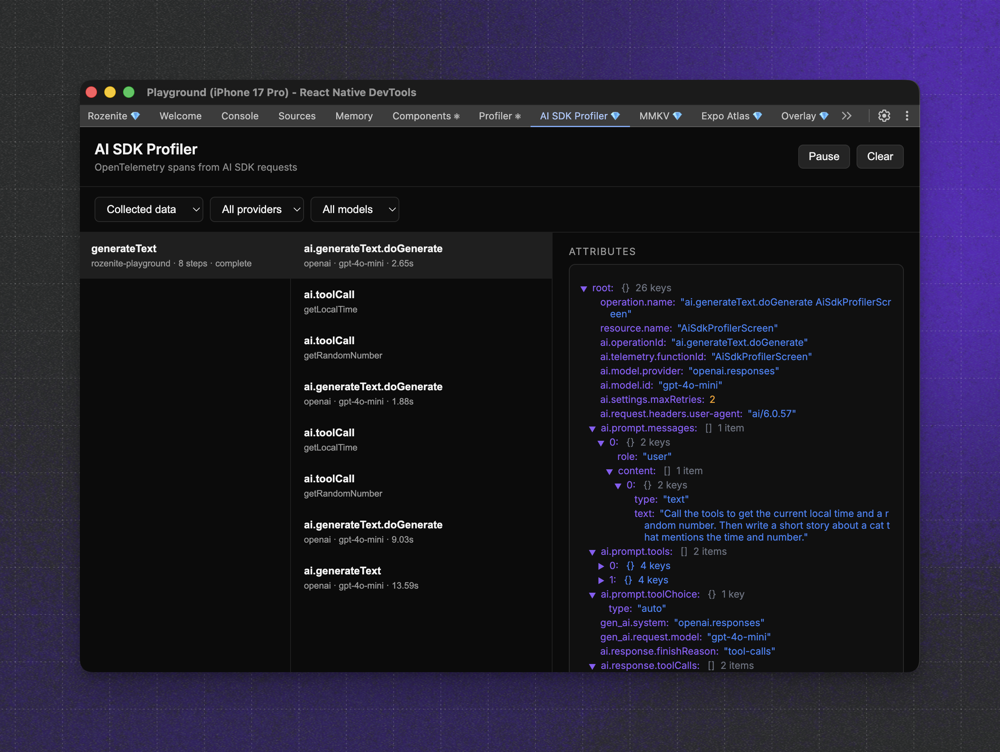

[](https://www.callstack.com/open-source?utm_campaign=generic&utm_source=github&utm_medium=referral&utm_content=react-native-ai)

# React Native AI

A collection of on-device AI primitives for React Native with first-class Vercel AI SDK support. Run AI models directly on users' devices for privacy-preserving, low-latency inference without server costs.

## Features

- 🚀 **Instant AI** - Use built-in system models immediately without downloads
- 🔒 **Privacy-first** - Inference runs on-device, so data stays local. Cloud models are opt-in
- 🎯 **Vercel AI SDK compatible** - Use `generateText`, `streamText`, `embed` and other AI SDK functions with local models
- 🎨 **Beyond text** - Embeddings, transcription, speech synthesis and image generation

## AI SDK Compatibility

| React Native AI | AI SDK |
| --------------- | ------ |
| 0.11 and below  | v5     |
| 0.12            | v6     |
| 0.13 and above  | v7     |

## DevTools



The AI SDK Profiler plugin captures OpenTelemetry spans from Vercel AI SDK
requests and surfaces them in Rozenite DevTools. DevTools are runtime
agnostic, so they work with on-device and remote runtimes.

```bash
npm install @react-native-ai/dev-tools
```

Rozenite must be installed and enabled in your app. See the
[Rozenite getting started guide](https://www.rozenite.dev/docs/getting-started).

The Expo demo app in [apps/expo-example](./apps/expo-example)
includes native-development Rozenite wiring for this plugin. Run the example
app, open React Native DevTools, and select `AI SDK Profiler` to inspect chat
spans emitted by the Vercel AI SDK.

If the `AI SDK Profiler` panel stays empty after you send a message, close the
React Native DevTools window and open a new one. A stale debugger session can
keep the panel mounted without receiving telemetry.

## Available Providers

| Provider            | Built-in | Platforms    | Runtime                                                             | Description                                                |
| ------------------- | -------- | ------------ | ------------------------------------------------------------------- | ---------------------------------------------------------- |
| [Apple](#apple)     | ✅ Yes   | iOS          | [Apple](https://developer.apple.com/documentation/FoundationModels) | Apple Foundation Models, embeddings, transcription, speech |
| [ADK](#google-adk)  | ✅ Yes   | Android      | [Google ADK](https://developer.android.com/ai/adk)                  | On-device Gemini Nano, with optional cloud Gemini          |
| [Llama](#llama)     | ❌ No    | iOS, Android | [llama.rn](https://github.com/mybigday/llama.rn)                    | Run GGUF models via llama.rn                               |

---

### Apple

Native integration with Apple's on-device AI capabilities. **Built-in** - no model downloads required, uses system models.

- **Text Generation** - Apple Foundation Models for chat and completion
- **Embeddings** - NLContextualEmbedding for 512-dimensional semantic vectors
- **Transcription** - SpeechAnalyzer for fast, accurate speech-to-text
- **Speech Synthesis** - AVSpeechSynthesizer for natural text-to-speech with system voices

#### Installation

```bash
npm install @react-native-ai/apple
```

No additional linking needed, works immediately on iOS devices (autolinked).

#### Usage

```typescript
import { apple } from '@react-native-ai/apple'
import {
  generateText,
  embed,
  transcribe,
  generateSpeech as speech,
} from 'ai'

// Text generation with Apple Intelligence
const { text } = await generateText({
  model: apple(),
  prompt: 'Explain quantum computing',
})

// Generate embeddings
const { embedding } = await embed({
  model: apple.embeddingModel(),
  value: 'Hello world',
})

// Transcribe audio
const { text: transcript } = await transcribe({
  model: apple.transcriptionModel(),
  audio: audioBuffer,
})

// Text-to-speech
const { audio } = await speech({
  model: apple.speechModel(),
  text: 'Hello from Apple!',
})
```

#### Availability

| Feature          | iOS Version | Additional Requirements    |
| ---------------- | ----------- | -------------------------- |
| Text Generation  | iOS 26+     | Apple Intelligence device  |
| Embeddings       | iOS 17+     | -                          |
| Transcription    | iOS 26+     | -                          |
| Speech Synthesis | iOS 13+     | iOS 17+ for Personal Voice |

See the [Apple documentation](https://react-native-ai.dev/docs/apple/getting-started) for detailed setup and usage guides.

---

### Google ADK

Run Gemini Nano on-device on Android through Google's [Agent Development Kit](https://developer.android.com/ai/adk). **Built-in** - Gemini Nano is provisioned by the system via AICore, so there are no model files to bundle and no API key. Cloud Gemini is available as an option.

- **Text Generation** - `generateText` and `streamText` with on-device Gemini Nano
- **Tool Calling** - Native ADK agent loop with JavaScript tool executors
- **Cloud Gemini** - Optional cloud inference via ADK `LlmAgent` when you need a larger model

#### Installation

```bash
npm install @react-native-ai/adk
```

> [!IMPORTANT]
> Requires Android `minSdkVersion` 26 and a physical device with AICore support (Android 14+) for Gemini Nano. Your app also needs packaging excludes for duplicate `META-INF` files, see the [getting started guide](https://react-native-ai.dev/docs/adk/getting-started).

#### Usage

```typescript
import { adk } from '@react-native-ai/adk'
import { generateText } from 'ai'

if (!(await adk.isAvailable())) {
  throw new Error('Gemini Nano is not available on this device')
}

await adk.prepareNano()

const { text } = await generateText({
  model: adk(),
  prompt: 'Explain quantum computing',
})
```

See the [ADK documentation](https://react-native-ai.dev/docs/adk/getting-started) for device checks, cloud Gemini, and tool calling.

---

### Llama

Run any GGUF model on-device using [llama.rn](https://github.com/mybigday/llama.rn). **Requires download** - models are downloaded from HuggingFace.

#### Supported Features

| Feature         | Method                   | Description                                   |
| --------------- | ------------------------ | --------------------------------------------- |
| Text Generation | `llama.languageModel()`  | Chat, completion, streaming, reasoning models |
| Embeddings      | `llama.embeddingModel()` | Text embeddings for RAG and similarity search |
| Speech          | `llama.speechModel()`    | Text-to-speech with vocoder models            |

#### Installation

```bash
npm install @react-native-ai/llama llama.rn react-native-blob-util
```

#### Usage

```typescript
import { downloadModel, llama } from '@react-native-ai/llama'
import { generateText } from 'ai'

// Download from HuggingFace (Model ID format: "owner/repo/filename.gguf")
const modelPath = await downloadModel(
  'bartowski/Qwen_Qwen3.5-2B-GGUF/Qwen_Qwen3.5-2B-Q4_K_M.gguf',
  (progress) => console.log(`Downloading: ${progress.percentage}%`)
)

// Create model instance
const model = llama.languageModel(modelPath)

// Initialize model (loads into memory)
await model.prepare()

// Generate text
const { text } = await generateText({
  model,
  messages: [
    { role: 'system', content: 'You are a helpful assistant.' },
    { role: 'user', content: 'Write a haiku about coding.' },
  ],
})

// Cleanup when done
await model.unload()
```

#### Model Compatibility

Any GGUF model from HuggingFace can be used. Use the format `owner/repo/filename.gguf` as the model ID. Popular choices include:

- `bartowski/Qwen_Qwen3.5-2B-GGUF/Qwen_Qwen3.5-2B-Q4_K_M.gguf`
- `bartowski/Llama-3.2-3B-Instruct-GGUF/Llama-3.2-3B-Instruct-Q4_K_M.gguf`
- `Qwen/Qwen2.5-1.5B-Instruct-GGUF/qwen2.5-1.5b-instruct-q4_k_m.gguf`

📚 **[View full Llama documentation →](https://react-native-ai.dev/docs/llama/getting-started)**

## JSON UI

`@react-native-ai/json-ui` lets a tool-calling model build React Native UI. The model calls tools that add, update, and delete nodes in a JSON spec, and `GenerativeUIView` renders it. It's designed for small on-device models with limited context.

```bash
npm install @react-native-ai/json-ui
```

See the [JSON UI documentation](https://react-native-ai.dev/docs/json-ui/getting-started).

## Documentation

Guides and API reference are available at [react-native-ai.dev](https://react-native-ai.dev).

## Contributing

Read the [contribution guidelines](/CONTRIBUTING.md) before contributing.

## Agent skills

This repository provides agent skills to help you integrate and use the packages. You can easily install them with:

`npx skills add https://github.com/callstackincubator/react-native-ai --skill react-native-ai-skills`

or manually by copying the `skills/` directory into your agent's skills directory (for example `.cursor/skills/`).

## Made with ❤️ at Callstack

**react-native-ai** is an open source project and will always remain free to use. If you think it's cool, please star it 🌟.

[Callstack][callstack-readme-with-love] is a group of React and React Native geeks, contact us at [hello@callstack.com](mailto:hello@callstack.com) if you need any help with these or just want to say hi!

---

Made with [create-react-native-library](https://github.com/callstack/react-native-builder-bob)

[callstack-readme-with-love]: https://callstack.com/?utm_source=github.com&utm_medium=referral&utm_campaign=react-native-ai&utm_term=readme-with-love
