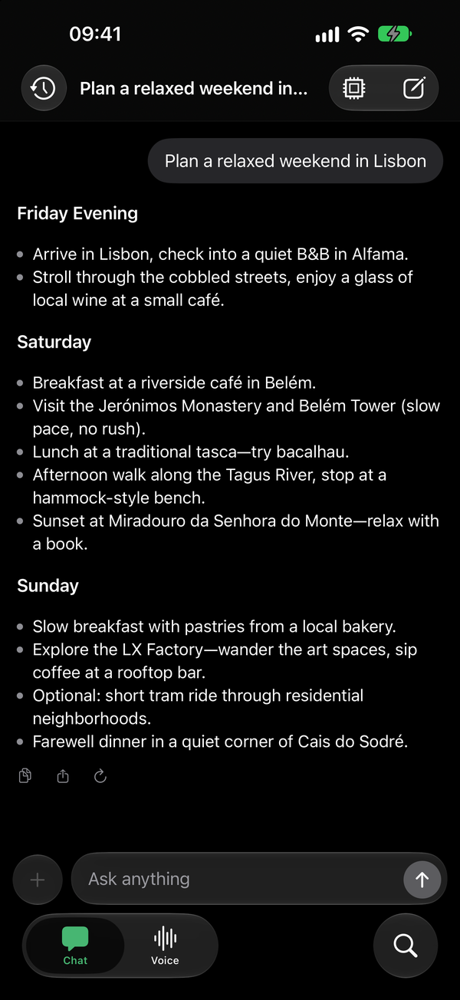
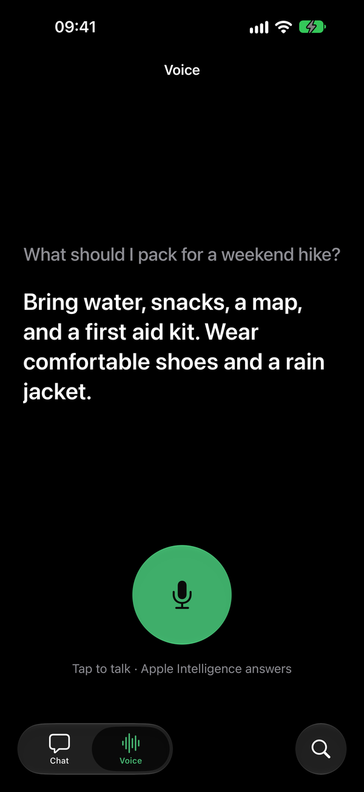
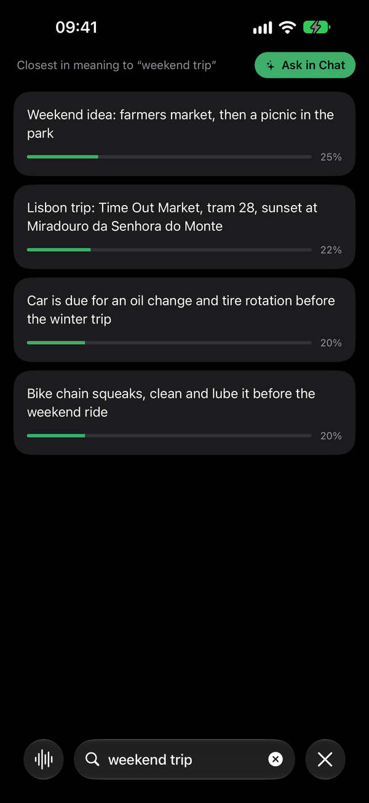
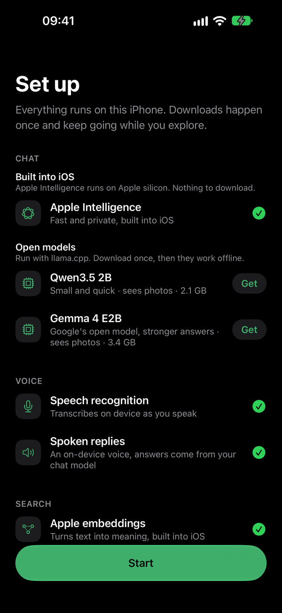

# React Native AI - Example App

<p>
  
  
  
  
</p>

An iOS app that shows what runs on an iPhone with React Native AI:

- **Chat** with Apple Intelligence, or with open models (Qwen3.5 2B, Gemma 4 E2B) that run with llama.cpp after a download. Replies stream as Markdown, reasoning models show their thinking, and photos can be attached to models that see them.
- **Voice**: talk to the chat model. Apple's speech recognition transcribes you live, and the reply is spoken back.
- **Search** your notes by meaning with Apple's on-device embeddings, and ask Chat about the closest ones.

Onboarding lets you pick features and sets up what each one needs. It is built with expo-router native tabs, `@expo/ui` SwiftUI views and liquid glass.

In the iOS Simulator, Voice hears a scripted question and Search matches shared words, because speech recognition and embeddings need a device. llama.cpp runs on the CPU there, so replies are slow.

## Running the App

```bash
bun run ios
```

## On-device Tests

The providers are tested with [React Native Harness](https://react-native-harness.dev), which runs the tests in [`harness/`](../../harness) at the repository root inside this app, against the real native modules and models. Each provider has a folder with one file per feature. Files ending in `.device.harness.ts` need a physical device.

Each command builds the app with the right flags, installs it, and runs the tests in it. Run the tests that don't need a physical device on an iPhone 18 Pro simulator with iOS 27:

```bash
bun run test:harness:simulator
```

Or run every test, including Core AI and Private Cloud Compute, on a physical device with Apple Intelligence, named as `xcrun devicectl list devices` shows it. Devices always connect to Metro on port 8081, so stop any Metro server running there first:

```bash
HARNESS_IOS_DEVICE="My iPhone" bun run test:harness:device
```

The device build sets `CORE_AI=1 PCC=1`:

- `CORE_AI=1` links `@react-native-ai/core-ai`, which needs an iOS 27 deployment target and can't build for the Simulator. The tests in [`harness/core-ai`](../../harness/core-ai) download their models on the first run.
- `PCC=1` adds Apple's managed Private Cloud Compute entitlement, so the team signing the app needs it, or the app crashes.

Both commands regenerate the `ios` folder, so run `npx expo prebuild --clean` afterwards to go back to the default build.

Pass a path such as `harness/apple` or `harness/apple/tools` to run part of the tests. The first llama run downloads about 2.5 GB of models.
